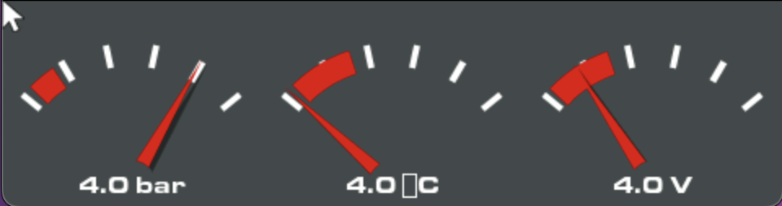

# Gauge-OS

**This code is based on VSCode Simulator project for LVGL**

[LVGL](https://github.com/lvgl/lvgl) is written mainly for microcontrollers and embedded systems, however you can run the library **on your PC** as well without any embedded hardware. The code written on PC can be simply copied when your are using an embedded system.

This project is pre-configured for VSCode and should work work on Windows, Linux and MacOs as well. FreeRTOS is also included and can be optionally enabled to better simulate embedded system's behavior.

## Goal

The main goal is for this software to run lightly on an ESP32-S3 and for this to handle an in-car interface that can be edited on the go. Which data to display, where and how. Each screen will have its standard base design of a gauge, being able to choose gauges' redline, number range and icon, also different color modes and way more down the line! Like ODB fault code reading and clearing.

## Preview

Current design (These gauges are set to match the VW Polo 6N2 cluster)

